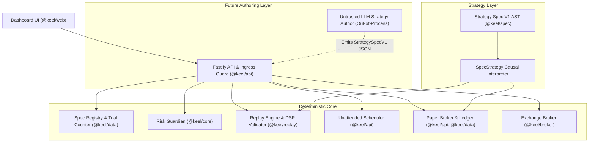

# Keel Systematic Trading Platform: Architecture & Strategy Spec System

## 1. System Philosophy & Invariants

Keel (`@keel/*`) is an autonomous, self-hosted crypto-derivatives research and execution platform engineered with mathematical rigor and defense-in-depth safety:

1. **Zero AI on the Money Path**:
   - The risk engine (`RiskGuardian`), execution broker (`OkxBroker`), double-entry ledger (`LedgerRepository`), reconciliation loop, and stop-loss placement are 100% deterministic with zero LLM or external AI dependencies.
2. **Exact Decimal Accounting**:
   - Every price, size, fee, funding cashflow, PnL, and balance is represented using arbitrary-precision `ScaledDecimal` (1e8 integer scaling). Floating-point arithmetic is strictly prohibited in domain accounting.
3. **Mandatory Exchange-Side Protective Stops**:
   - Every live or demo order is submitted with an attached exchange-side protective stop (OKX conditional algo order). Unconditional market/limit orders without stops are forbidden at the domain boundary.
4. **Hermetic Sealed Holdouts**:
   - Research is restricted strictly to confirmed in-sample history (2023-01-01 to 2024-12-31 UTC). The 2025 holdout partition is scientifically spent, and the 2026 holdout partition is sealed and quarantined behind single-use atomic access tokens.
5. **Non-Bypassable Human Gates (G1 / G2 / G3)**:
   - **G1**: End of research grilling and spec approval before writing application code.
   - **G2**: Step-up multi-factor authentication (MFA) before placing orders on any exchange account (including Demo).
   - **G3**: Step-up MFA before enabling real-money live execution.

---

## 2. Platform Architecture & Layering

### Layer Descriptions

- **`@keel/core`**: Domain entities, ports, `ScaledDecimal`, config schema registry, risk models, and `@ts-rest` API contracts.
- **`@keel/spec`**: Declarative `StrategySpecV1` AST schema, recursive canonical JSON hashing (`computeSpecHash`), deterministic plain-English generator (`describeSpec`), and pure causal interpreter (`SpecStrategy`).
- **`@keel/data`**: SQLite WAL persistence for market bars, funding rates, double-entry ledger, immutable experiment records, monotonic research trials counter, and strategy spec registry.
- **`@keel/replay`**: Event-driven backtesting engine with next-bar-open execution, gap-aware slippage, 2x cost stress, purged walk-forward cross-validation, and Deflated Sharpe Ratio calculation.
- **`@keel/broker`**: OKX V5 REST integration featuring attached algo orders, position/order reconciliation, and 60-second Dead-Man's Switch heartbeat.
- **`@keel/api`**: Fastify backend providing IngressGuard (Cloudflare JWT + Argon2id + RFC 6238 TOTP), unattended scheduler, and Prometheus metrics.
- **`@keel/web`**: React dashboard displaying real-time metrics, risk limits, ledger balance, experiment results, and strategy AST inspector.

---

## 3. Declarative Strategy Specification (V1 AST)

Rather than executing arbitrary code or compiling bespoke classes, systematic strategies are defined as declarative JSON documents validated against `StrategySpecV1Schema` (ADR-0020):

- **Bounded Indicator Library**: Whitelist of deterministic technical indicators (`donchian`, `atr`, `sma`, `stddev`, `zscore`, `momentum`).
- **Lookahead-Free AST**: Conditions composed of `NumExpr` (constants, bar fields, indicators, arithmetic) and `Condition` (comparisons, logical ops, crosses) evaluated exclusively on confirmed bars up to `asOfMs`.
- **Attached Risk Rules**: Mandatory `stopModel` (`atr_multiple`, `channel_bound`, `fixed_points`) and limit `takeProfit` target.
- **Canonical Parameter Hashing (`specHash`)**: Deterministic recursive key sorting producing a 64-character SHA-256 hex digest invariant to JSON formatting or key permutation.
- **Plain-English Auditability**: Every specification generates an unambiguous English description for operator review without LLM hallucination.

---

## 4. Spec Registry, Trial Accounting, and Quarantine Ladder

Under ADR-0021, the strategy lifecycle is governed by strict mathematical and operational invariants:

1. **Monotonic Research Trial Coupling**:
   - Under Harvey & Liu (2014), evaluating multiple parameter sets inflates false discovery rates.
   - When a unique `specHash` is registered in `StrategySpecRepository`, it automatically increments the monotonic `research_trials` counter, ensuring Deflated Sharpe Ratio (DSR) penalties cannot be evaded by restarting services or deleting rows.
2. **Permanent Promotion Quarantine**:
   - Strategies flagged with `synthetic: true` (or prefixed with `synthetic-`) exist exclusively for algorithmic testing and fixture calibration.
   - The promotion endpoint (`POST /api/v1/promotion/promote`) strictly rejects promotion of synthetic strategies to `Demo`, `Live-Ramp`, or `Live` with `403 Forbidden`.
3. **Promotion Ladder Stages**:
   - `Research` $\to$ `Paper` (unattended paper trading) $\to$ `Demo` (Gate G2: exchange testnet with attached stops) $\to$ `Live-Ramp` (Gate G3: restricted real capital) $\to$ `Live` (Gate G3: full production allocation).

---

## 5. Future Out-of-Process LLM Authoring

In subsequent phases, AI authoring will sit safely on top of this deterministic foundation:

- The LLM will operate as an untrusted external agent emitting declarative `StrategySpecV1` JSON.
- The platform will validate the AST schema at the API boundary, compute the canonical `specHash`, record the research trial, and execute deterministic walk-forward evaluations.
- No LLM output will ever execute arbitrary code, modify risk controls, or place exchange orders directly.
